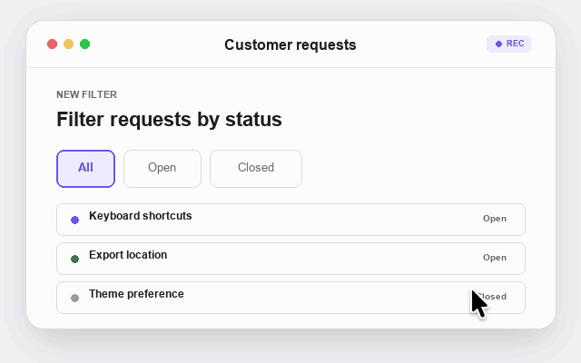

  

<h1 align="center">GifJot</h1>

  <strong>Show it. Don’t explain it.</strong> 
  Record any part of your Mac screen and paste it as a GIF.

  <a href="https://github.com/jamkoo/gifJot/releases/latest/download/GifJot.dmg"><strong>Download for macOS</strong></a>
  ·
  <a href="https://gifjot.com"><strong>Website</strong></a>
  ·
  <a href="https://github.com/jamkoo/gifJot/releases/latest">Latest release</a>
  ·
  <a href="SUPPORT.md">Support</a>

  <strong>No account</strong> ·
  <strong>No uploads</strong> ·
  <strong>No watermark</strong> ·
  <strong>Local processing</strong>

  macOS 14+ · Apple silicon and Intel · Version 0.1.5

GifJot is a free, lightweight, native macOS menu-bar app. Select a region,
record a few clear seconds, stop, and paste the finished GIF where your
explanation belongs. There is no account, upload, telemetry, advertising,
watermark, or third-party runtime dependency.

## Made for quick explanations

| Bug report | Product update | Support reply |
| :---: | :---: | :---: |
|  |  |  |
| Catch the bug | Demo the update | Show the setting |

## A GIF in three steps

1. Press `Option-Command-G`, then drag around the part of the screen you want
   to show.
2. Capture a few seconds, then stop when the point is clear.
3. GifJot saves the GIF locally and can copy it to your clipboard.

## Built for focused screen sharing

- **Local by design.** Recording and GIF creation happen on your Mac.
- **Paste-ready output.** Save locally and optionally copy the completed GIF
  straight to the clipboard.
- **Useful controls.** Configure output size, frame rate, countdown, pointer
  visibility, click markers, save location, and the global shortcut.
- **Native and universal.** Runs as a menu-bar app on Apple silicon and Intel
  Macs.
- **Small on purpose.** No editor, audio, webcam, cloud sharing, or extra export
  formats.

## Install

1. Download [`GifJot.dmg`](https://github.com/jamkoo/gifJot/releases/latest/download/GifJot.dmg).
2. Open the disk image and drag **GifJot** to **Applications**.
3. Open GifJot. It appears in the menu bar rather than the Dock.
4. Grant Screen Recording access when macOS asks, then reopen GifJot if
   prompted.

The public download is a universal app signed with an Apple Developer ID,
notarized by Apple, and stapled for normal Gatekeeper verification.

### Requirements

- macOS 14 Sonoma or later
- Apple silicon or Intel Mac
- Screen Recording permission

## Your screen stays on your Mac

GifJot processes recordings locally and works without an account. The Mac app
does not include uploads, analytics, advertising, telemetry, or crash-reporting
services. Completed GIFs remain in the folder you choose until you move or
delete them.

Read the complete [privacy statement](PRIVACY.md).

## Project links

- [gifjot.com](https://gifjot.com) — product website and download
- [Latest release](https://github.com/jamkoo/gifJot/releases/latest) — version,
  release notes, and alternate download
- [Changelog](CHANGELOG.md) — product changes by version
- [Support](SUPPORT.md) — bug reports, requests, and contact
- [Security policy](SECURITY.md) — private vulnerability reporting

Mobile website preview

  

## About this repository

This is GifJot’s public download and documentation repository. It contains
compiled releases, product information, policies, and public issue tracking.
The application source code is private, so this repository does not accept code
contributions.

## License

GifJot is **free proprietary software**. You may download and use the compiled
app at no charge under the [GifJot Freeware License](LICENSE.txt). No
source-code rights are granted.

Copyright (c) 2026 James Koo. All rights reserved.
