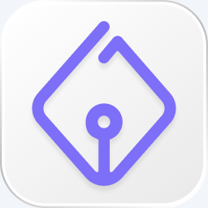
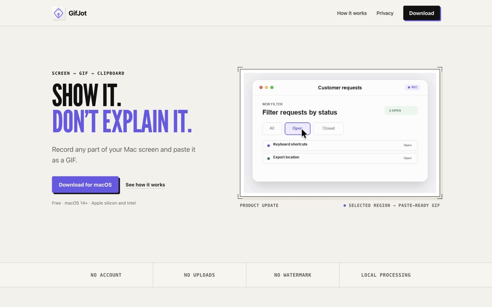
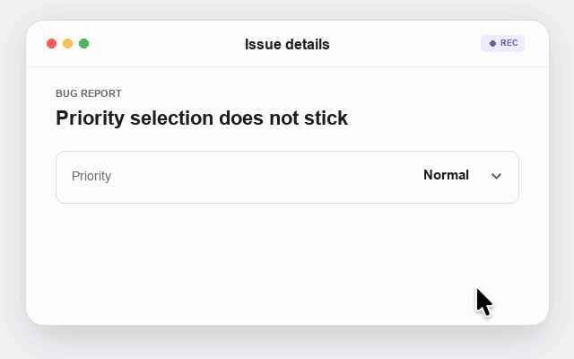
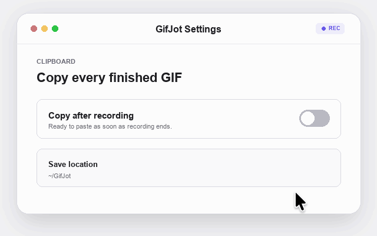
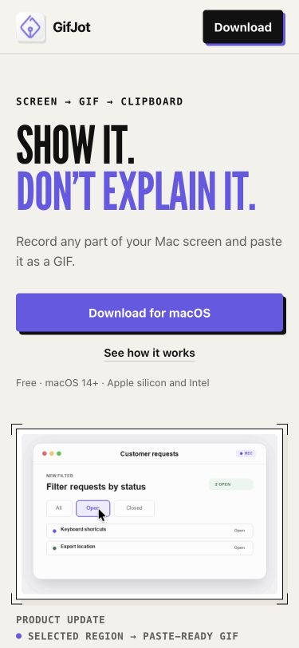

  

<h1 align="center">GifJot</h1>

  <strong>Show it. Don’t explain it.</strong> 
  Record a GIF or capture a PNG from any part of your Mac, then paste it.

  <a href="https://github.com/jamkoo/gifJot/releases/latest/download/GifJot.dmg"><strong>Download for macOS</strong></a>
  ·
  <a href="https://gifjot.com"><strong>Website</strong></a>
  ·
  <a href="https://gifjot.com/blog"><strong>Guides</strong></a>
  ·
  <a href="https://github.com/jamkoo/gifJot/releases/latest">Latest release</a>
  ·
  <a href="SUPPORT.md">Support</a>

  <strong>No account</strong> ·
  <strong>No uploads</strong> ·
  <strong>No watermark</strong> ·
  <strong>Local processing</strong>

  Public beta · macOS 14+ · Apple silicon · Version 0.1.15

GifJot is a free, lightweight, native macOS menu-bar app. Select a region,
record a few clear seconds or capture a still, then paste the finished GIF or
PNG where your explanation belongs. There is no account, upload, app telemetry,
advertising, or watermark.

## Made for quick explanations

| Bug report | Product update | Support reply |
| :---: | :---: | :---: |
|  |  |  |
| Catch the bug | Demo the update | Show the setting |

## Practical guides

- [Record your Mac screen as a GIF](https://gifjot.com/blog/record-screen-as-gif-mac)
- [Add a GIF to a GitHub issue](https://gifjot.com/blog/gif-for-github-issue)
- [Make a clear bug report on Mac](https://gifjot.com/blog/visual-bug-report-mac)
- [Choose GIF or video for a bug report](https://gifjot.com/blog/gif-vs-video-bug-report)
- [Annotate a screenshot on Mac](https://gifjot.com/blog/annotate-screenshot-mac)

## A GIF or PNG in three steps

1. Press `Option-Command-G` for a GIF or `Option-Command-S` for a PNG, then
   drag around the part of the screen you want to show.
2. Record a short loop or freeze a still. Reuse the last area when you need
   another take.
3. GifJot saves locally, can copy the result, and offers Jot for lightweight
   annotations.

## Built for focused screen sharing

- **Local by design.** Recording and GIF creation happen on your Mac.
- **Paste-ready output.** Save locally and optionally copy the completed GIF or
  PNG straight to the clipboard.
- **Useful controls.** Configure output size, frame rate, countdown, pointer
  visibility, click markers, save location, shortcuts, completion behavior,
  and same-area capture.
- **Jot when useful.** Add a pen mark, arrow, rectangle, text, or QA stamp to a
  completed capture without uploading it.
- **Apple-silicon public beta.** The universal release includes an Intel slice
  for compatibility testing, but Apple silicon is the primary validated
  platform for this beta.
- **Small on purpose.** No audio, webcam, timeline editor, cloud sharing, or
  account setup.

## Install

1. Download [`GifJot.dmg`](https://github.com/jamkoo/gifJot/releases/latest/download/GifJot.dmg).
2. Open the disk image and drag **GifJot** to **Applications**.
3. Open GifJot. It appears in the menu bar rather than the Dock.
4. Grant Screen Recording access when macOS asks, then reopen GifJot if
   prompted.

The public download is a universal app signed with an Apple Developer ID,
notarized by Apple, and stapled for normal Gatekeeper verification.

### Requirements

- macOS 14 Sonoma or later
- Apple silicon Mac for the primary public beta
- Screen Recording permission

The universal download includes an Intel architecture for compatibility
testing. Intel users are welcome to try it and report their Mac model and macOS
version with any issue, but Intel does not yet have equivalent physical-test
coverage.

## Your screen stays on your Mac

GifJot processes captures locally and works without an account. The Mac app
does not include uploads, analytics, advertising, telemetry, or crash-reporting
services. Completed GIFs and PNGs remain in the folder you choose until you
move or delete them. The app checks GitHub Releases for signed updates through
Sparkle; no capture content or usage event is sent with that request.

Read the complete [privacy statement](PRIVACY.md).

## Project links

- [gifjot.com](https://gifjot.com) — product website and download
- [Latest release](https://github.com/jamkoo/gifJot/releases/latest) — version,
  release notes, and alternate download
- [Changelog](CHANGELOG.md) — product changes by version
- [Support](SUPPORT.md) — bug reports, requests, and contact
- [Security policy](SECURITY.md) — private vulnerability reporting

Mobile website preview

  

## About this repository

This is GifJot’s public download and documentation repository. It contains
compiled releases, product information, policies, and public issue tracking.
The application source code is private, so this repository does not accept code
contributions.

## License

GifJot is **free proprietary software**. You may download and use the compiled
app at no charge under the [GifJot Freeware License](LICENSE.txt). No
source-code rights are granted.

Copyright (c) 2026 James Koo. All rights reserved.
